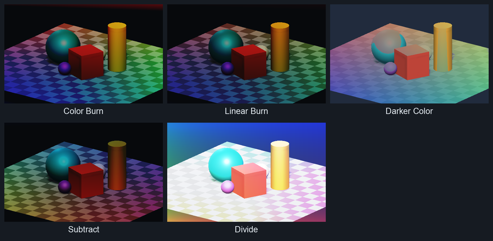
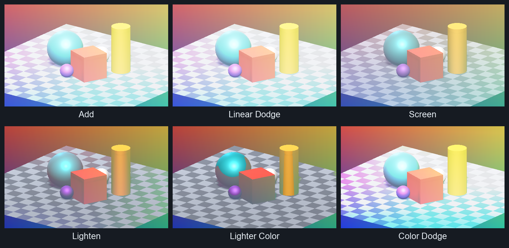
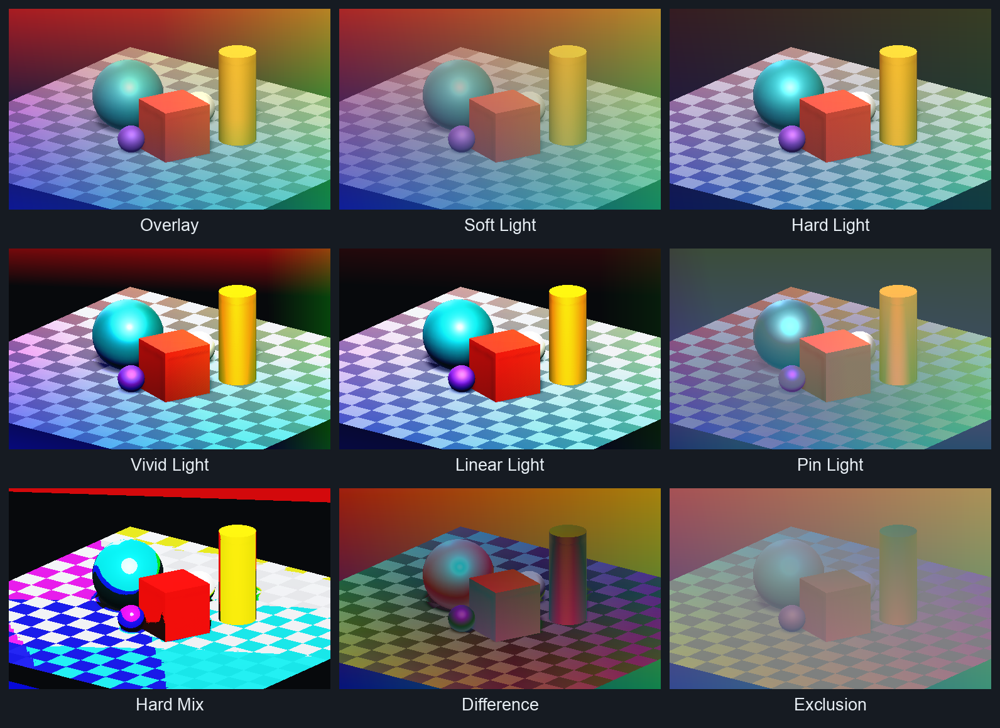
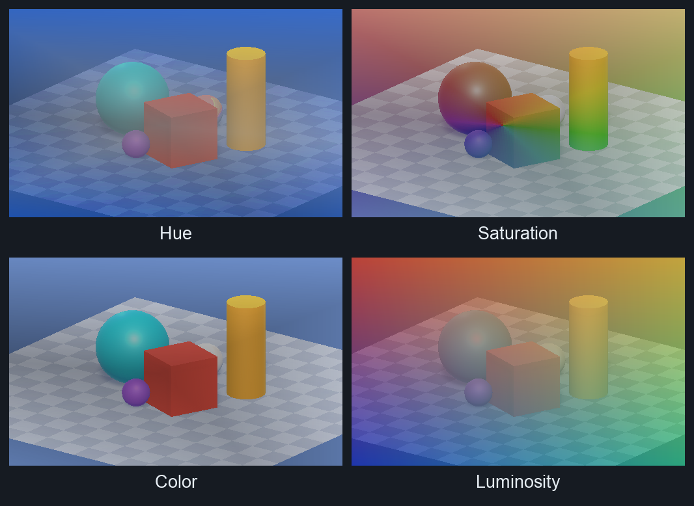
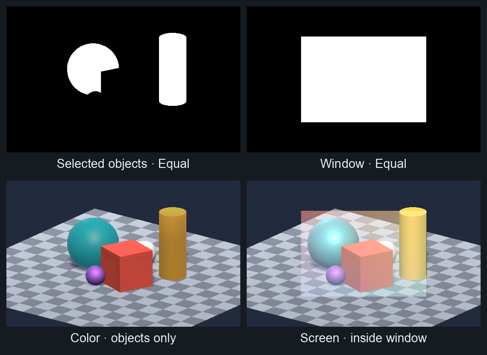

# Changelog

## [legacy-2019-09-18](https://github.com/penandlim/JL-s-Unity-Blend-Modes/releases/tag/legacy-2019-09-18) — legacy snapshot

Published 2026-10-27, pinned to [`a46e41be35177d9587bd1562eda27bb678dc1249`](https://github.com/penandlim/JL-s-Unity-Blend-Modes/commit/a46e41be35177d9587bd1562eda27bb678dc1249). All 24 shader sources are unchanged from that release.

RGB previews rendered in Unity 6000.6.7f1 · Built-in/Metal · Gamma project · orthographic camera · 80% layer opacity · no tints. These are new captures of the legacy code, not historical Unity 2019 screenshots.

**Inputs** — the reference scene and gradient used throughout.

**Darkening & arithmetic** — Color Burn, Linear Burn, Darker Color, Subtract, and Divide.

**Lightening** — Add, Linear Dodge, Screen, Lighten, Lighter Color, and Color Dodge.

**Contrast & differences** — Overlay through Exclusion.

**Color components** — Hue, Saturation, Color, and Luminosity.

**Stencil masks** — Color on selected objects; Screen inside a window. White marks affected pixels.

This release has no Multiply, Normal, Dissolve, Darken, or blend-space selector.
