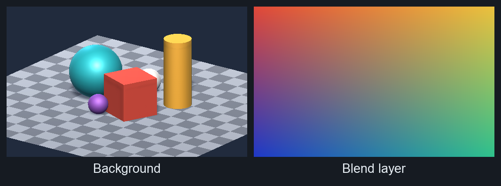
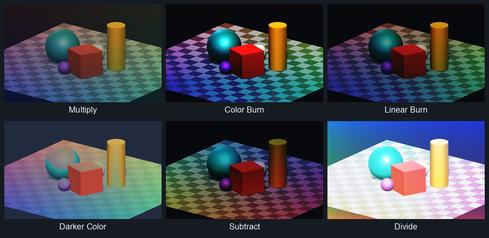
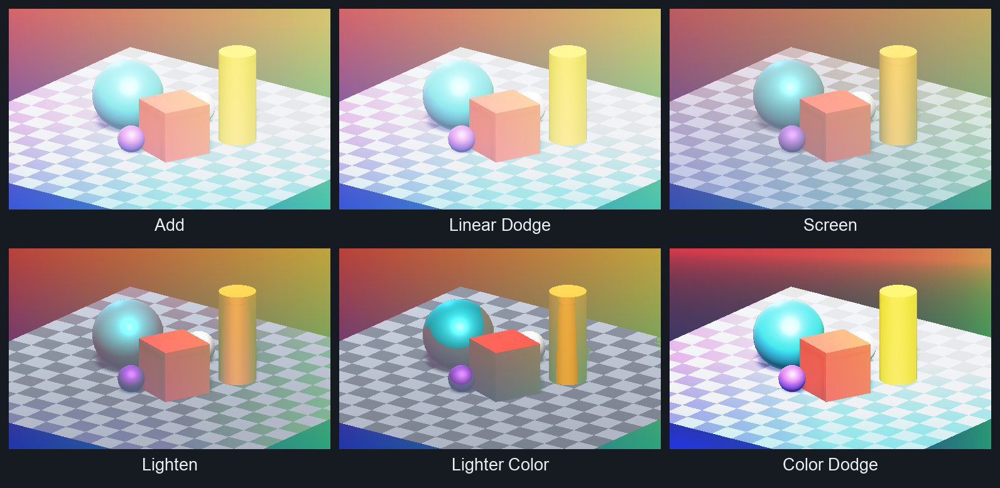
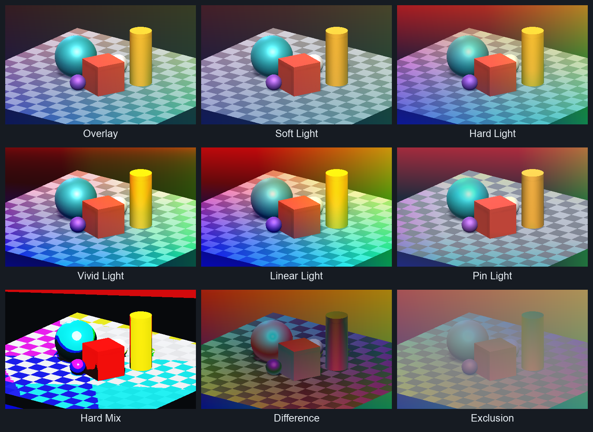
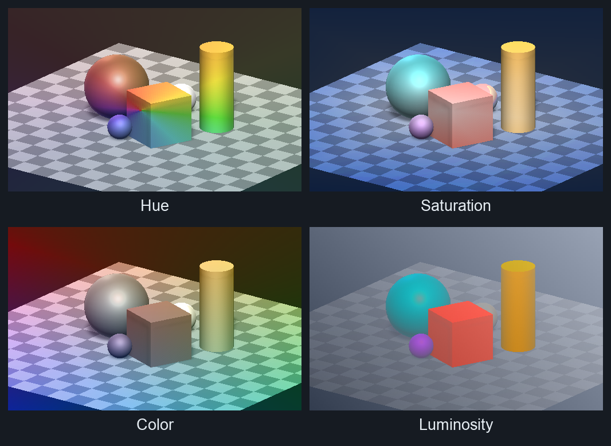
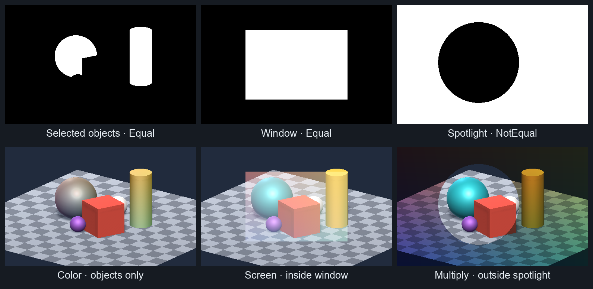

# JL's Unity Blend Modes
Collection of Unity shaders that support blend modes like photoshop layer style (Darken, Multiply, Linear Burn, etc)

Each shader applies given texture from sprite renderer to the texture from Unity's GrabPass, emulaitng the blend effect of photoshop layers.

Built for screen space effect but feel free to modify it by replacing GrabPass to other textures.
GrabPass sampling supports both orthographic and perspective cameras in Unity's Built-in Render Pipeline.

You can also use Stencil properties to limit the overlay effect to certain objects in the scene.

# Samples

Unity 6000.6.7f1 · Built-in/Metal · Gamma · orthographic camera. Same inputs, 80% layer opacity, no tints.

**Multiply & arithmetic** — darken, burn, subtract, or divide.

**Lightening** — brighten colors and highlights.

**Contrast & differences** — from soft contrast to posterization and inversion.

**Color components** — transfer hue, saturation, color, or luminosity. Color preserves background luminosity; muted blend colors still desaturate.

**Stencil masks** — recolor selected objects, brighten a window, or darken outside a spotlight. White regions receive the effect; black regions stay unchanged.

Masks write stencil ID `1` first; blend layers use `Equal` or `NotEqual` with the stencil operation set to `Keep`.

# Usage
1. Add a UI Canvas to your project.

2. Add a sprite renderer as a child

3. Add an image with desired colors/opacity/gradient.

4. Add a material with a shader thats in "Blendmodes/" category

5. Adjust tint and opacity of the blend layer accordingly.

# Special thanks
https://github.com/supyrb/ConfigurableShaders
