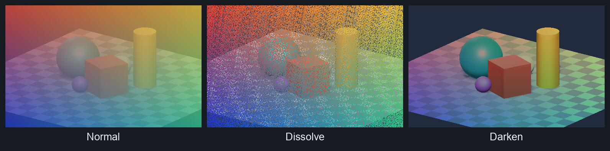
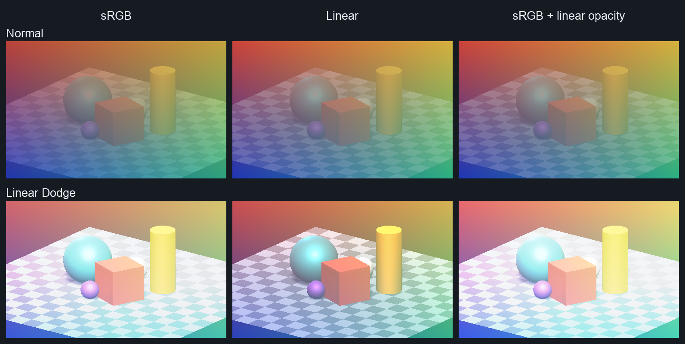
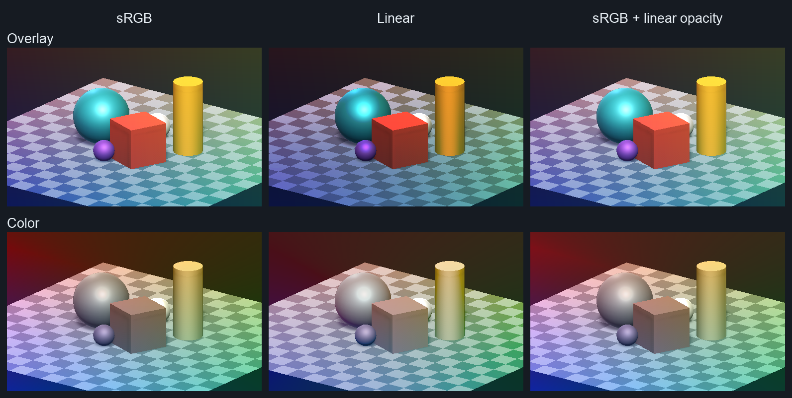

# JL's Unity Blend Modes
Collection of Unity shaders that support blend modes like photoshop layer style (Darken, Multiply, Linear Burn, etc)

Shaders blend sprite textures with the accumulated screen background using Unity's GrabPass.

Built for screen space effect but feel free to modify it by replacing GrabPass to other textures.
GrabPass sampling supports both orthographic and perspective cameras in Unity's Built-in Render Pipeline.

You can also use Stencil properties to limit the overlay effect to certain objects in the scene.

# Samples

Unity 6000.6.7f1 · Built-in/Metal · orthographic camera. These galleries use **Project blending (`_BlendSpace = 0`) in a Gamma project**, equivalent to sRGB blending here. Same inputs, 80% layer opacity, no tints.

**Basics** — normal layering, opacity-driven speckles, and per-channel darkening.

**Multiply & arithmetic** — darken, burn, subtract, or divide.

**Lightening** — brighten colors and highlights.

**Contrast & differences** — from soft contrast to posterization and inversion.

**Color components** — transfer hue, saturation, color, or luminosity. Hue, Saturation, and Color preserve background luminosity; muted blend colors can still desaturate.

**Stencil masks** — recolor selected objects, brighten a window, or darken outside a spotlight. White regions receive the effect; black regions stay unchanged.

Masks write stencil ID `1` first; blend layers use `Equal` or `NotEqual` with the stencil operation set to `Keep`.

# Blending color space

Set **Blending Color Space** on each material (`_BlendSpace`):

| Selection | Blend formulas and tints | Opacity compositing |
| --- | --- | --- |
| Project (`0`, default) | Unity project space | Unity project space |
| sRGB (`1`) | Encoded sRGB | Encoded sRGB |
| Linear (`2`) | Linear-light RGB | Linear-light RGB |
| sRGBLinearOpacity (`3`) | Encoded sRGB | Linear-light RGB |

Explicit selections use sRGB primaries and piecewise sRGB transfer functions, then return premultiplied RGB in Unity's project space. Use sRGB imports for color textures. RGB blend-factor controls are evaluated in the selected compositing space; alpha remains source-over.

`sRGBLinearOpacity` follows the linear-opacity behavior observed in [published 8-bit Photoshop Normal, Multiply, Linear Dodge, and Screen samples](https://github.com/cinight/PSBlendModes/tree/6000.0/Assets/Test/PhotoshopReference). This is not a general Photoshop/ICC-profile parity guarantee. Texture/vertex precision, lighting, later compositing, and tone mapping can still affect the final image.

## Blend-space comparisons

Same scene and gradient, **Gamma project**, **80% opacity**, no tints. Only `_BlendSpace` changes.

**Normal & Linear Dodge** — Normal isolates opacity differences; Linear Dodge also changes with formula space.

**Overlay & Color** — contrast and color transfer also change with the selected space.

# Rendering notes

- Blend inputs and mode results are bounded to `[0,1]`, including on HDR targets. This changes prior unbounded output; it does not tone-map the remaining background. Divide treats a zero divisor as white, including `0/0`.
- Transparent targets use **premultiplied RGB**: clear to `(0,0,0,0)`, supply premultiplied backdrop content, and composite the resulting texture with `One, OneMinusSrcAlpha`.
- Sorting Layer and Order in Layer control stacking. Each renderer captures the accumulated background, costing one GrabPass per layer. Compositing uses this resolved screen copy, not per-sample MSAA data.
- Tint 1 affects the source; Tint 2 affects the mode result in overlapping regions. Dissolve converts combined texture, vertex, and material opacity into stable pixel coverage, not Photoshop's exact random pattern.

# Usage
1. Add a UI Canvas to your project.

2. Add a sprite renderer as a child

3. Add an image with desired colors/opacity/gradient.

4. Add a material with a shader thats in "Blendmodes/" category

5. Adjust tint and opacity of the blend layer accordingly.

# Special thanks
https://github.com/supyrb/ConfigurableShaders
